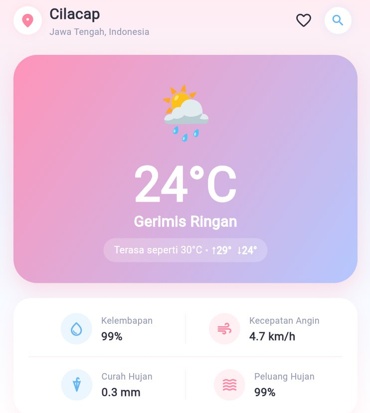
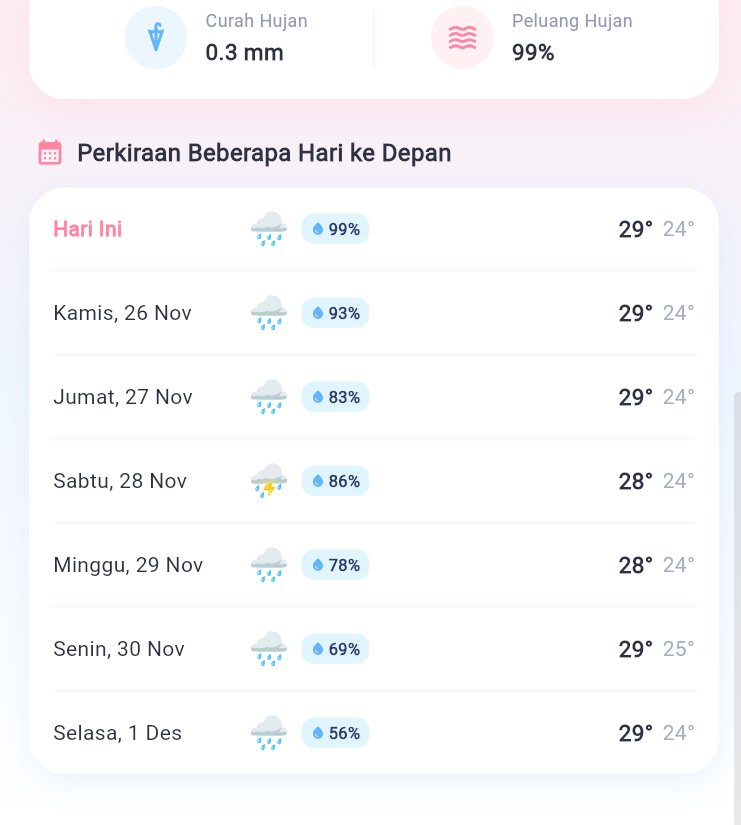
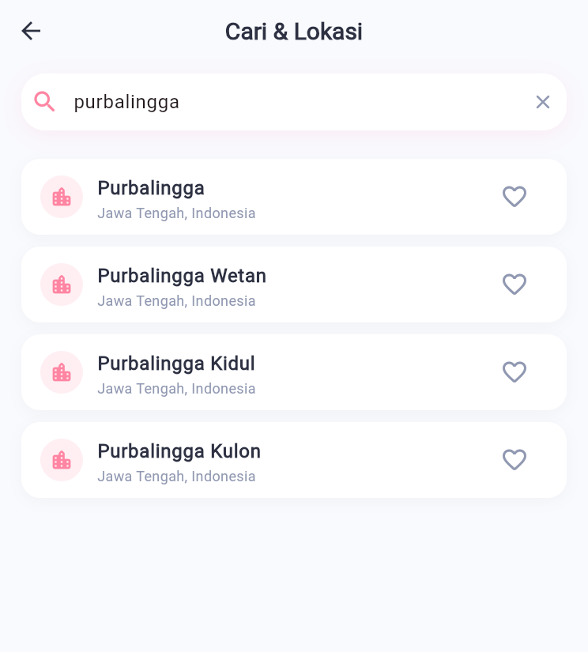

# LangitKu - Aplikasi Pemantau Cuaca
**Responsi Praktikum Pemrograman Mobile (Flutter)**

Aplikasi pemantau cuaca berbasis Flutter yang menerapkan pola arsitektur Model-View-ViewModel (MVVM) dan mengonsumsi REST API publik dari Open-Meteo secara dinamis.

---

## 1. Identitas Mahasiswa
- **Nama**: Novia Aryani
- **NIM**: H1D024041
- **Repository**: [H1D024041-Responsi-Praktikum-Pemrograman-Mobile-Flutter](https://github.com/noviaaryani/H1D024041-Responsi-Praktikum-Pemrograman-Mobile-Flutter)

---

## 2. Screenshot Aplikasi

| Home Screen (Cuaca Terkini) | Home Screen (Perkiraan Harian) | Search Screen (Pencarian Lokasi) |
| :---: | :---: | :---: |
|  |  |  |

---

## 3. Arsitektur Aplikasi (MVVM)

Aplikasi dibangun dengan memisahkan kode program ke dalam tiga lapisan utama untuk menjaga keteraturan, kemudahan pengujian, dan skalabilitas kode:

```text
lib/
├── models/                     # [Model] Representasi data & parsing JSON dari API
│   ├── location_model.dart     # Model geocoding data lokasi kota
│   └── weather_model.dart      # Model cuaca terkini dan perkiraan cuaca harian
├── services/                   # [Service] Layer komunikasi API & penyimpanan lokal
│   ├── weather_service.dart    # HTTP Request GET ke Open-Meteo REST API
│   └── storage_service.dart    # Penyimpanan lokal SharedPreferences
├── viewmodels/                 # [ViewModel] Logika bisnis & manajemen state (Provider)
│   ├── weather_viewmodel.dart  # Pengelolaan state cuaca (loading, success, error)
│   └── search_viewmodel.dart   # Pengelolaan state pencarian & data favorit
├── views/                      # [View] Antarmuka pengguna (UI)
│   ├── home_screen.dart        # Layar utama informasi cuaca & forecast harian
│   ├── search_screen.dart      # Layar pencarian lokasi, riwayat, & bookmark favorit
│   └── widgets/                # Komponen widget modular terpisah
├── theme/
│   └── app_theme.dart          # Konfigurasi Material Design Theme
└── main.dart                   # Entry point aplikasi & inisialisasi MultiProvider
```

### Penjelasan Komponen MVVM:
1. **Model**:
   - `LocationModel`: Memetakan respons data JSON dari Geocoding API Open-Meteo menjadi objek Dart.
   - `WeatherData` & `DailyForecastItem`: Memetakan data cuaca terkini dan forecast harian dari Weather Forecast API Open-Meteo.
2. **View**:
   - `HomeScreen`: Menampilkan nama lokasi terpilih, kondisi cuaca, suhu saat ini, kelembapan, kecepatan angin, curah hujan, peluang hujan, dan perkiraan cuaca beberapa hari ke depan. Dilengkapi penanganan kondisi loading dan error.
   - `SearchScreen`: Menyediakan input teks pencarian kota, daftar hasil pencarian dari API, daftar lokasi favorit, dan riwayat pencarian.
3. **ViewModel**:
   - `WeatherViewModel`: Bertindak sebagai penghubung antara `HomeScreen` dan `WeatherService`. Mengelola state status (`initial`, `loading`, `success`, `error`) menggunakan `ChangeNotifier` dan `Provider`.
   - `SearchViewModel`: Mengelola proses pencarian kota ke API, menyimpan riwayat pencarian, dan memperbarui daftar lokasi favorit secara reaktif.

---

## 4. Implementasi REST API Open-Meteo

Aplikasi mengonsumsi dua endpoint resmi Open-Meteo menggunakan metode HTTP GET:

1. **Geocoding API**:
   - **Endpoint**: `https://geocoding-api.open-meteo.com/v1/search`
   - **Parameter**: `name`, `count=10`, `language=id`, `format=json`
   - **Fungsi**: Mencari koordinat garis lintang (latitude) dan garis bujur (longitude) berdasarkan nama kota yang diinput pengguna secara dinamis.

2. **Weather Forecast API**:
   - **Endpoint**: `https://api.open-meteo.com/v1/forecast`
   - **Parameter Utama**:
     - `latitude` & `longitude`: Koordinat lokasi terpilih.
     - `timezone`: `auto` (menyesuaikan zona waktu lokasi secara otomatis).
     - `current`: Mengambil data cuaca terkini:
       - `temperature_2m`: Suhu saat ini.
       - `relative_humidity_2m`: Kelembapan udara.
       - `apparent_temperature`: Suhu yang dirasakan.
       - `precipitation`: Curah hujan.
       - `weather_code`: Kode kondisi cuaca.
       - `wind_speed_10m`: Kecepatan angin.
     - `daily`: Mengambil data perkiraan harian:
       - `temperature_2m_max`: Suhu maksimum harian.
       - `temperature_2m_min`: Suhu minimum harian.
       - `precipitation_probability_max`: Peluang hujan maksimum harian.
       - `weather_code`: Kode cuaca perkiraan harian.

---

## 5. Implementasi Local Storage

Aplikasi mengimplementasikan library `shared_preferences` untuk penyimpanan data secara lokal dan persisten di perangkat:
- **Lokasi Favorit**: Menyimpan daftar kota favorit yang ditandai oleh pengguna agar tetap tersimpan saat aplikasi ditutup dan dibuka kembali.
- **Riwayat Pencarian**: Menyimpan riwayat pencarian terakhir pengguna untuk memudahkan pencarian ulang.
- **Lokasi Terakhir**: Menyimpan lokasi terakhir yang sedang dibuka sehingga ketika aplikasi dibuka kembali, data cuaca lokasi tersebut langsung ditampilkan secara otomatis.

---

## 6. Panduan Menjalankan Proyek

1. Clone repositori ini:
   ```bash
   git clone https://github.com/noviaaryani/H1D024041-Responsi-Praktikum-Pemrograman-Mobile-Flutter.git
   cd H1D024041-Responsi-Praktikum-Pemrograman-Mobile-Flutter
   ```

2. Unduh semua paket dependensi:
   ```bash
   flutter pub get
   ```

3. Jalankan aplikasi pada perangkat yang terhubung (Chrome, Emulator, atau Perangkat Fisik):
   ```bash
   flutter run
   ```
